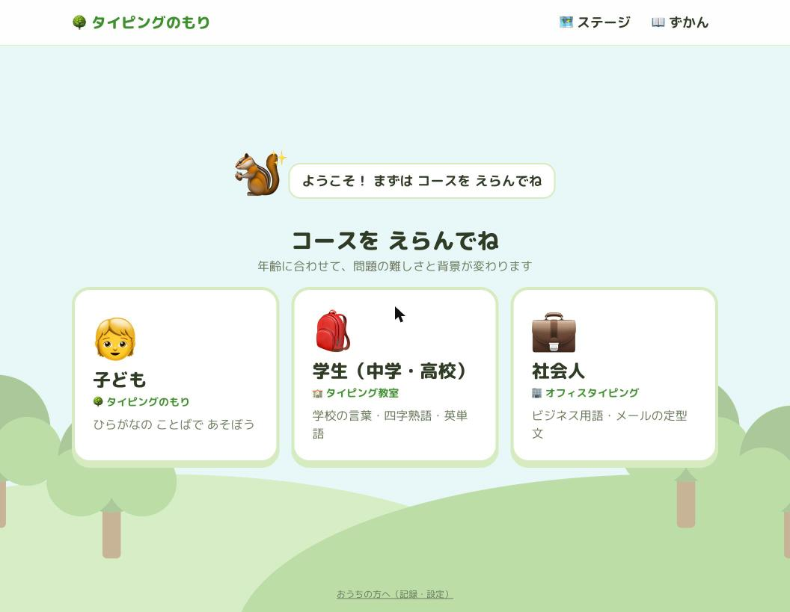
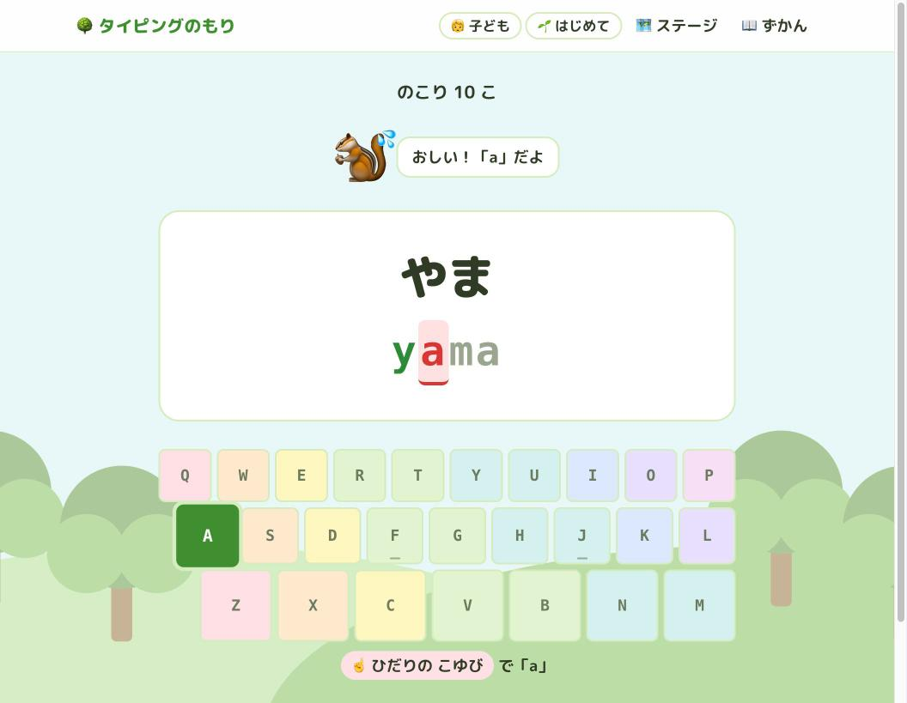
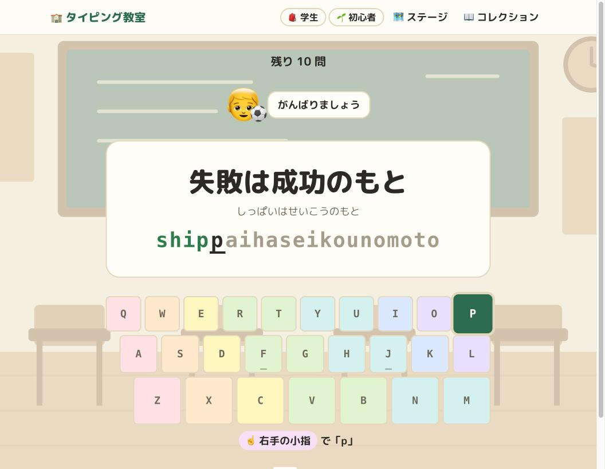
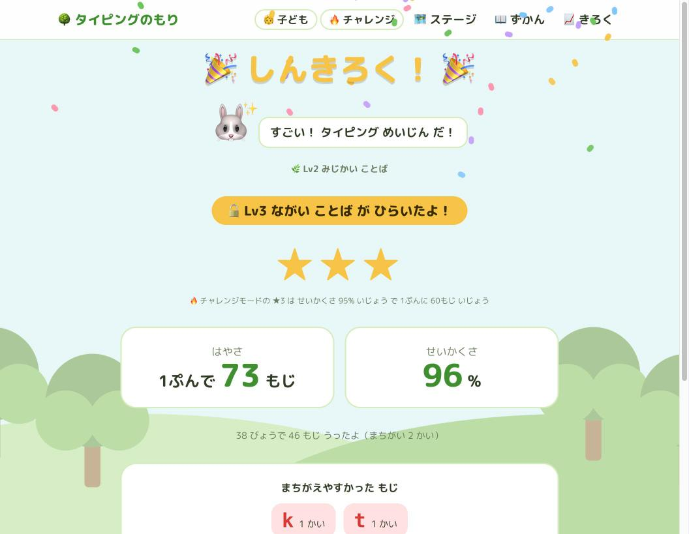
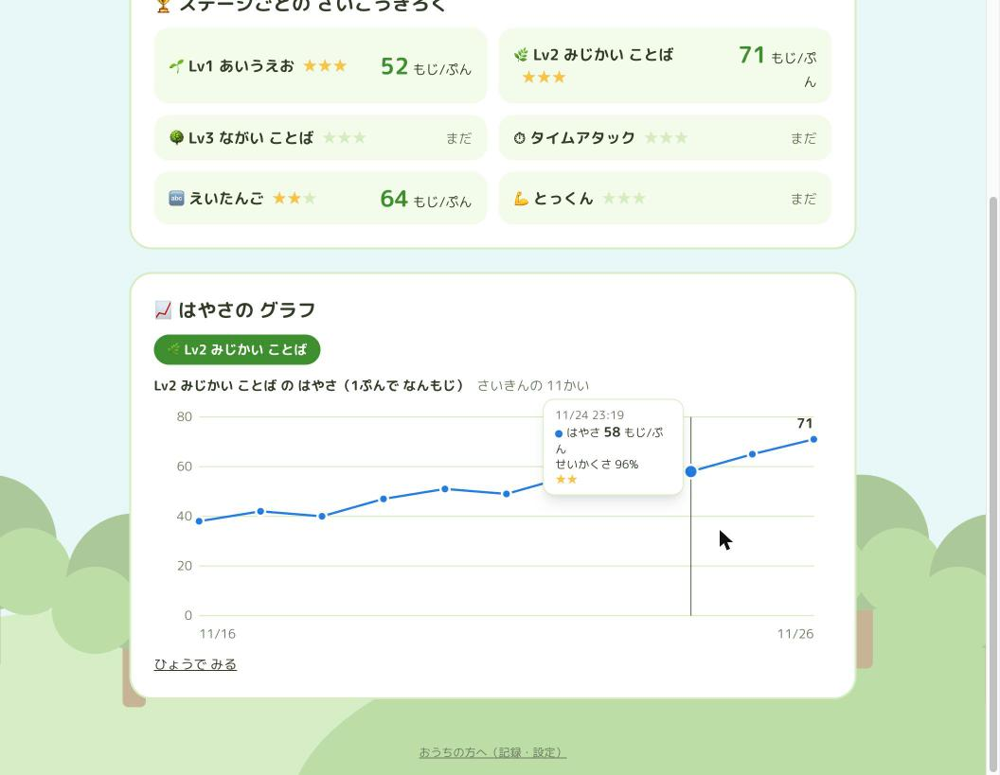

# タイピングのもり

表示された言葉をローマ字で打ち込み、**速さ（1分あたりの文字数）と正確さ** を測るタイピング練習アプリです。
間違えた文字は赤く表示し、過去の最高記録を保存します。

最初に **コース（🧒 子ども／🎒 学生（中学・高校）／💼 社会人）** と **モード（🌱 初心者／🔥 チャレンジ）** を選ぶと、
背景・問題の難しさ・★の基準・画面の言葉・キャラクターが、年齢と目的に合わせて変わります。

**デモ：https://typing-mori.vercel.app**

記録はブラウザの中（localStorage）にだけ保存され、サーバーには送られません。名前などの個人情報も入力しません。

## スクリーンショット

| コースを選ぶ | 子ども（森・初心者モード） | 学生（教室） |
| :---: | :---: | :---: |
|  |  |  |

| 社会人（オフィス・チャレンジモード） | けっか | きろく（グラフ） |
| :---: | :---: | :---: |
|  |  |  |

## 主な機能

- **1文字ずつの判定**：合えば緑、間違えたら赤。正しいキーを打つまで先に進まない（Backspace 不要）
- **ローマ字のゆれ対応**：shi/si・tsu/tu・chi/ti、ん の n/nn、っ（ppa・xtu）など、どの打ち方でも正解。お手本も打ち方に合わせて変わる
- **速さ・正確さ・★**：速さ＝正しく打った文字数 ÷ 経過分、正確さ＝正しい打鍵 ÷ 全打鍵。★1〜3 の基準はコース×モードで変わる
- **最高記録**：ステージごと・コースごとに保存し、超えたら「新記録！」と紙ふぶき。「あと ◯文字で新記録」も表示
- **コース**（子ども／学生／社会人）
  - 背景：森／教室（黒板・時計・机）／会社の社内（窓の外のビル・デスク）
  - 問題：ひらがなの言葉 → 学校の言葉・四字熟語・ことわざ → ビジネス用語・メールの定型文（漢字で表示して読みを打つ）
  - キャラクター：動物たち／担任の先生・校長先生・部活の生徒／上司・社長・新人の後輩・同期。口ぐせで声をかける
- **モード**（ペルソナに合わせる）
  - 初心者：画面キーボードと指のガイドを常に表示、時間は出さない、★が取りやすい、ミス音がやわらかい
  - チャレンジ：入力中の速さと正確さを表示、タイムアタック、記録ページのグラフ
- **ステージ**：Lv1〜3（★3 で次が解放）、60秒タイムアタック、英単語、苦手な文字を集めた「苦手克服」
- **続ける仕掛け**：★でもらえるシール 15 枚とコレクション、毎日スタンプ（連続日数）
- **おうちの方へ**：練習の記録一覧、速さのグラフ、効果音・指のガイドのオン/オフ、全データの削除
- キーボードだけで操作できる（Space で開始、Esc で中断、Enter でもう一度）、ダークモード対応

## 技術スタック

| 分類 | 使っているもの |
| --- | --- |
| フレームワーク | [Next.js](https://nextjs.org) 16（App Router・Turbopack） |
| UI | [React](https://react.dev) 19、TypeScript 5 |
| スタイル | [Tailwind CSS](https://tailwindcss.com) v4（CSS 変数でコース別の色・ダークモードを切り替え） |
| 背景・グラフ | インライン SVG（画像ファイルやグラフのライブラリは使わない） |
| 効果音 | Web Audio API（音のファイルは使わず、その場で音を作る） |
| フォント | M PLUS Rounded 1c（`next/font/google`） |
| データの保存 | localStorage（記録）・sessionStorage（あそぶ → けっかの受け渡し） |
| ホスティング | [Vercel](https://vercel.com) |

データベースや外部 API は使っていません。

## しくみのポイント

- **キー入力**：`keydown` イベントで1文字ずつ判定。日本語入力がオンで `e.key` が `"Process"` のときは `e.code`（`KeyA` など）から文字を取る（`lib/keys.ts`）
- **ローマ字の判定**：ひらがなを音のまとまりに分け、それぞれに打ち方の候補を持たせる。打った文字がどれかの候補の続きなら進む（`lib/romaji.ts`）
- **タイマー**：最初の正しいキーで開始し、`performance.now()` との差を 0.1 秒ごとに表示（`components/Game.tsx`）
- **記録の保存**：コースごとの最高記録・★・ミス集計を `progress` に分けて保存し、画面からは今のコースの分だけが見える（`lib/storage.ts`）

## 起動

```bash
npm install
npm run dev
```

http://localhost:3000 を開きます。

## 資料

作る前に用意した資料です。

- [ユーザーストーリーマップ](docs/タイピング練習-story-map.html)
- [サイトマップ・ページ一覧](docs/タイピング練習-sitemap.html)
- [要件定義書](docs/タイピング練習-要件定義書.md)

## ディレクトリ構成

```
app/          ページ（/・/stages・/play・/result・/stickers・/records・/parents）
components/   Game（あそぶ画面）・Keyboard・Character・Background・SpeedChart など
lib/          romaji（ローマ字判定）・words / wordlists（問題）・storage（保存）・texts（画面の言葉）など
docs/         資料とスクリーンショット
```
